  

<h3 align="center">Building full-stack applications with Java, Spring Boot, React, and SQL</h3>

  BE in Information Science & Engineering

  Open to <b>Frontend, Backend, Full Stack Developer</b> opportunities

  
  
  

  

<table>
<tr>
<td>

- 🎓 B.E. in Information Science & Engineering | CGPA: 8.75/10
- 💼 Full Stack + AI Engineer at **Scale IT OS**
- 💻 Java Full-Stack Developer Intern at **Palle Technologies**
- ⚙️ Java, Spring Boot, React.js, Flask, REST APIs & SQL
- 🤖 Interested in AI-powered applications and full-stack development
- 🚀 Open to **Software Engineer & Full Stack Developer** opportunities
- 📍 Bengaluru, India

</td>
</tr>
</table>

